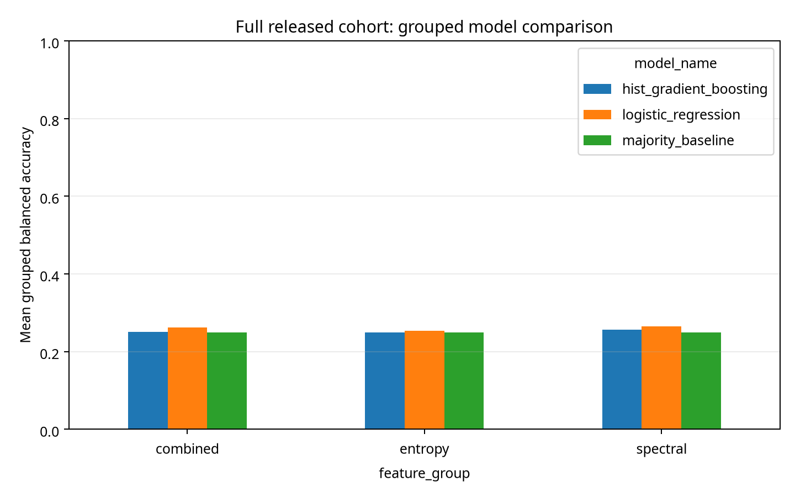

# NeuroScale Lab

*A reproducible scientific data platform for multiscale neural complexity and cognitive workload modeling.*

[](https://github.com/SoheilGtex/neuroscale-lab/actions)
[](https://github.com/SoheilGtex/neuroscale-lab/releases/tag/v0.1.0)

## Research snapshot

**NeuroScale Lab** is a reproducible research software platform testing whether
EEG permutation-entropy features provide incremental predictive value over
conventional spectral features for cognitive workload classification.

| Metric | Full-cohort result |
|---|---:|
| Participants | 18 |
| EEG channels per participant | 19 |
| Retained task events | 4,442 |
| Per-channel feature records | 1,012,776 |
| Spectral logistic regression (balanced accuracy) | 0.2655 |
| Combined logistic regression (balanced accuracy) | 0.2616 |
| Four-class majority baseline | 0.2500 |

**Exploratory finding:** Entropy-derived features did not demonstrate an
incremental predictive benefit over the spectral-only logistic baseline in
five-fold participant-grouped evaluation. This does not establish that neural
entropy is generally uninformative; the results are neither clinical nor causal.

**[Download v0.1.0 and the full-cohort SQLite database](https://github.com/SoheilGtex/neuroscale-lab/releases/tag/v0.1.0)**




## Research questions

1. Do permutation entropy and multiscale permutation entropy add information beyond conventional EEG spectral features when workload is varied by a 1–4-back task?
2. Do any associations or predictive gains generalize to participants not seen during training?

The project is designed to support negative and inconclusive findings. The synthetic demo verifies software plumbing only; it is not evidence about EEG or workload.

## Verified primary dataset

The starting dataset is **Multimodal Cognitive Workload n-back Task, 4 Difficulties**, NEMAR `on007169`, version `v1.0.0`, derived from OpenNeuro `ds007169` version `1.0.5`. The NEMAR record reports 18 released participants, 19 EEG channels, 250 Hz sampling, four n-back conditions, CC0 licensing, and two exclusions for data-quality failures. The BIDS event dictionary defines `nback_level`, `trial_type`, response fields, tutorial flags, and dropout annotations. See `docs/dataset-audit.md` for the evidence record and citations.

## Quick start

```bash
python3 -m venv .venv
source .venv/bin/activate
python -m pip install -e '.[dev]'
make test
make lint
make demo
```

The demo creates `results/demo/neuroscale.sqlite` and inserts explicitly labeled synthetic epochs and derived features. It is deterministic under seed `20261014`.

## Full-cohort release

The current verified empirical run covers all 18 released participants. It retained 4,442 of 8,665 labeled task events after excluding tutorials, dropout-overlapping windows, and one boundary-invalid epoch. Per-channel extraction generated 1,012,776 feature rows, integrated them into SQLite, and evaluated spectral-only, entropy-only, combined, and majority-baseline models with participant-grouped five-fold cross-validation. See `results/full-cohort/research-report.md`, `docs/verification-manifest.json`, and `docs/statistical-analysis-plan.md`.

```bash
# Run tests, lint, and a small synthetic demo (does not download EEG recordings)
make verify

# Inspect the already-published full-cohort feature table
python -c "import pandas as pd; t = pd.read_parquet('results/full-cohort/features.parquet'); print('Feature rows:', len(t)); print('Participants:', t['subject_code'].nunique())"
```

To reprocess the full cohort from raw EEG, download the version-pinned dataset
using the acquisition scripts and follow the research documentation. The raw
recordings and large SQLite database are intentionally excluded from Git.


The public raw files are downloaded separately and excluded from release archives. The full-cohort result is observational and exploratory; it is not a clinical or causal claim.

## Repository map

- `src/neuroscale/features/`: permutation entropy, multiscale coarse-graining, and spectral features.
- `src/neuroscale/database/`: SQLite initialization with foreign keys, checks, indexes, and an analysis view.
- `tests/`: numerical and relational integrity tests.
- `docs/`: dataset audit, scientific methods, architecture, limitations, and reproducibility notes.
- `research/`: downloaded public metadata used to audit the dataset; raw EEG is intentionally not committed.

## Real-data status

The public dataset is accessible and its metadata was downloaded and inspected. Phase 3 processes the complete released cohort with explicit dropout QC, Welch PSD, channel-preserving features, grouped evaluation, SQLite integration, SQL benchmarks, and generated figures. The final report records the exact limitations and exploratory status.

## License and citation

Software is MIT licensed. The dataset is CC0. Cite the dataset separately:

> Barras, M., & Booth, L. (2026). *Multimodal Cognitive Workload n-back Task, 4 Difficulties* (Version v1.0.0) [Data set]. NEMAR. https://doi.org/10.82901/nemar.on007169

## Quality policy

Every validation item is classified as `PASS`, `FAIL`, or `NOT RUN`. No scientific conclusion is reported until it comes from downloaded, verified data and a participant-grouped evaluation.
