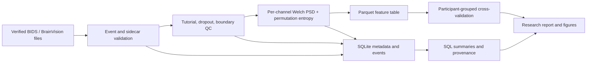

# Architecture

Raw public BIDS files remain outside the repository. The ingestion boundary records dataset version, source URI, hashes, and parsed event semantics. SQLite stores normalized metadata, channel relationships, provenance, and experiment registration. Parquet stores the high-volume channelized feature table; SQLite remains the metadata and provenance source of truth.

The current executable path is: resumable full-cohort acquisition → event validation and shared QC → per-channel MNE epoch features → Parquet export → grouped statistical and ML evaluation → SQLite integration and integrity checks. The deterministic fixture path remains available through `make verify`.

This is intentionally workstation-oriented. If data volume grows, acquisition and feature extraction can be partitioned by participant while retaining immutable run manifests and participant-level grouped splits. Distributed infrastructure is not justified for the current dataset and protocol.

## Implemented pipeline

The contract is deliberate: SQLite stores normalized participant, session, recording, channel, event, QC, run, artifact, feature, and model entities. Parquet stores the high-volume derived feature records. The database does not become a raw-signal store, and the Parquet table is not treated as a substitute for provenance.
